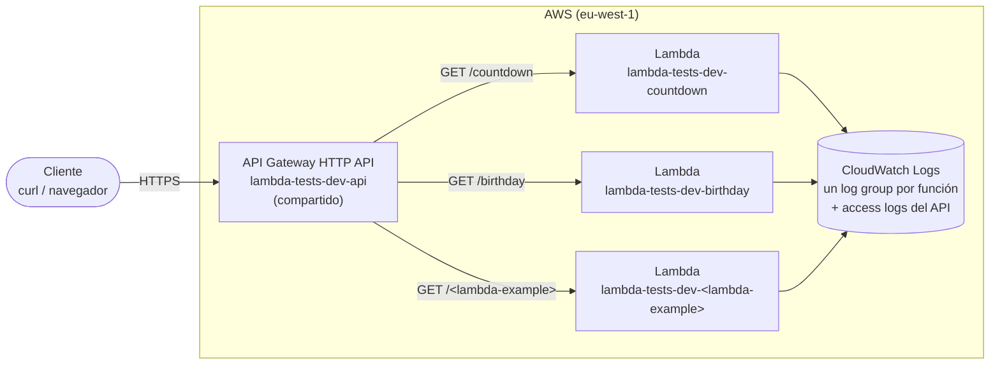

# Lambda-Tests

Proyecto para desplegar **varias funciones AWS Lambda** (Node.js) con Terraform y publicarlas por HTTPS detrás de **un único API Gateway HTTP API**. Cada función vive en su propia carpeta `lambdas/<nombre>/` y se activa añadiendo una entrada en un mapa de configuración.

> **Entorno de trabajo:** todos los comandos se ejecutan en la **consola Linux Ubuntu de WSL**, dentro de `~/Lambda-Tests`. No uses PowerShell ni CMD, ni ejecutes Terraform sobre la ruta `\\wsl.localhost\...`.

## Contenido

1. [Arquitectura](#arquitectura)
2. [Estructura del proyecto](#estructura-del-proyecto)
3. [Funciones disponibles](#funciones-disponibles)
4. [Inicio rápido](#inicio-rápido)
5. [Cómo añadir una nueva función Lambda](#cómo-añadir-una-nueva-función-lambda)
6. [Cómo quitar una función](#cómo-quitar-una-función)
7. [Más documentación](#más-documentación)

## Arquitectura



- **Un API, muchas rutas.** Todas las funciones comparten el API, su stage y el throttling. Cada función tiene **su ruta, su rol IAM, su log group y su función Lambda**.
- **La configuración es un mapa.** En [`terraform/environments/dev/terraform.tfvars`](terraform/environments/dev/terraform.tfvars), la variable `lambdas` dice qué funciones se despliegan. La clave de cada entrada es el nombre de su carpeta en `lambdas/`.
- **Sin VPC ni costes fijos.** Solo se paga por uso (ver [costes](terraform/README.md#costes-en-aws)).
- El estado de Terraform se guarda en un bucket S3 creado por [`terraform/bootstrap`](terraform/bootstrap/README.md).

## Estructura del proyecto

```
Lambda-Tests/
├── README.md                      # este documento
├── lambdas/                       # código: una carpeta por función
│   ├── birthday/
│   │   ├── index.js
│   │   └── README.md
│   └── countdown/
│       ├── index.js
│       └── README.md
└── terraform/
    ├── README.md                  # despliegue paso a paso, costes, seguridad, problemas
    ├── bootstrap/                 # bucket S3 del estado (una vez por cuenta)
    ├── environments/dev/          # entorno dev: terraform.tfvars con el mapa "lambdas"
    └── modules/                   # iam, cloudwatch, lambda, api-gateway
```

## Funciones disponibles

| Función | Ruta | Descripción | Documentación |
|---|---|---|---|
| `countdown` | `GET /countdown` | Tiempo que falta para Año Nuevo | [lambdas/countdown/README.md](lambdas/countdown/README.md) |
| `birthday` | `GET /birthday` | Tiempo que falta para el próximo 5 de enero | [lambdas/birthday/README.md](lambdas/birthday/README.md) |

Al añadir una función, añade también su fila a esta tabla.

## Inicio rápido

La guía completa (instalación de herramientas, credenciales y bucket de estado) está en [terraform/README.md](terraform/README.md#guía-de-despliegue-paso-a-paso). Resumen, con el bucket de estado ya creado:

```bash
cd ~/Lambda-Tests/terraform/environments/dev
terraform init
terraform plan -out=tfplan
terraform apply tfplan

terraform output api_urls          # URL de cada función
curl -s "$(terraform output -raw api_endpoint)/countdown"; echo
curl -s "$(terraform output -raw api_endpoint)/birthday"; echo
```

Revisar sin desplegar nada:

```bash
cd ~/Lambda-Tests/terraform
terraform fmt -recursive -check -diff
(cd environments/dev && terraform init -backend=false -input=false && terraform validate)
```

## Cómo añadir una nueva función Lambda

Esta guía usa como ejemplo una función llamada **`<lambda-example>`**. En todos los pasos, **sustituye `lambda-example` por el nombre de tu función**. El nombre:

- Solo puede tener minúsculas, números y guiones (`^[a-z0-9-]+$`). Terraform lo valida.
- Es a la vez el nombre de la carpeta (`lambdas/lambda-example/`), la clave en `terraform.tfvars` y el sufijo de los recursos en AWS.

`lambda-example` es solo un ejemplo de documentación: no existe en el repositorio ni se despliega.

### Paso 1. Crear la carpeta y el código

```bash
cd ~/Lambda-Tests
mkdir -p lambdas/lambda-example
```

Crea `lambdas/lambda-example/index.js`. Esta plantilla sirve de punto de partida: lee el evento del API (payload 2.0) y devuelve la respuesta en el formato que espera API Gateway:

```js
// lambdas/lambda-example/index.js
exports.handler = async (event) => {
    // Datos útiles del evento (API Gateway HTTP API, payload 2.0)
    const method = event.requestContext?.http?.method;   // "GET"
    const path   = event.rawPath;                          // "/lambda-example"
    const query  = event.queryStringParameters || {};      // ?nombre=Ana -> { nombre: "Ana" }
    const body   = event.body
        ? JSON.parse(event.isBase64Encoded ? Buffer.from(event.body, "base64").toString() : event.body)
        : null;

    // Variables de entorno definidas en terraform.tfvars
    const saludo = process.env.SALUDO || "hola";

    console.log(JSON.stringify({ method, path, query }));  // va a CloudWatch Logs

    try {
        const nombre = query.nombre || "mundo";

        return {
            statusCode: 200,
            headers: { "Content-Type": "application/json" },
            body: JSON.stringify({ message: `${saludo}, ${nombre}`, method, path, body })
        };
    } catch (err) {
        console.error(err);
        return {
            statusCode: 500,
            headers: { "Content-Type": "application/json" },
            body: JSON.stringify({ error: "Error interno" })
        };
    }
};
```

Reglas:

- El archivo y la función exportada deben coincidir con `handler` (por defecto `index.handler` → `index.js` con `exports.handler`).
- Devuelve siempre `{ statusCode, headers, body }`, con `body` como **texto** (`JSON.stringify`).
- **Dependencias npm:** si añades un `package.json`, ejecuta `npm ci --omit=dev` dentro de `lambdas/lambda-example/` antes del `apply`. Todo lo que hay en la carpeta entra en el zip.

### Paso 2. Documentar la función

Crea `lambdas/lambda-example/README.md`. Puedes copiar el de [countdown](lambdas/countdown/README.md) o el de [birthday](lambdas/birthday/README.md) como plantilla, o empezar con este esqueleto:

````markdown
# Función `lambda-example`

<Qué hace la función, en una o dos frases.>

← [Volver al README del proyecto](../../README.md)

## Resumen

| Dato | Valor |
|---|---|
| Código | [`index.js`](index.js) |
| Ruta del API | `GET /lambda-example` |
| Nombre en AWS (dev) | `lambda-tests-dev-lambda-example` |
| Log group | `/aws/lambda/lambda-tests-dev-lambda-example` |
| Runtime / memoria / timeout | `nodejs22.x` / 256 MB / 10 s |
| Variables de entorno | `SALUDO` |
| Permisos extra | Ninguno |

## Configuración en Terraform
<La entrada de terraform.tfvars.>

## Petición y respuesta
<Parámetros que acepta, ejemplo de curl y de respuesta, códigos de estado.>

## Probar
<Comandos para probar en local y desplegada.>

## Problemas frecuentes
````

Añade también su fila a la tabla [Funciones disponibles](#funciones-disponibles).

### Paso 3. Declararla en Terraform

Añade la entrada al mapa `lambdas` de [`terraform/environments/dev/terraform.tfvars`](terraform/environments/dev/terraform.tfvars). **No hay que tocar ningún `.tf`**:

```hcl
lambdas = {
  countdown = {
    route_key = "GET /countdown"
  }

  birthday = {
    route_key = "GET /birthday"
  }

  lambda-example = {
    route_key   = "GET /lambda-example"         # obligatorio y único
    memory_size = 256                           # opcional (por defecto 128 MB)
    timeout     = 15                            # opcional (por defecto 10 s)
    environment_variables = {                   # opcional (por defecto ninguna)
      SALUDO = "hola"
    }
    # runtime = "nodejs22.x"                    # opcional
    # handler = "index.handler"                 # opcional
  }
}
```

| Campo | Obligatorio | Por defecto | Descripción |
|---|---|---|---|
| `route_key` | Sí | — | `"<MÉTODO> /ruta"`. Ejemplos: `"GET /lambda-example"`, `"POST /lambda-example"`, `"GET /lambda-example/{id}"`, `"ANY /lambda-example"`. No se puede repetir. |
| `runtime` | No | `"nodejs22.x"` | Runtime de Lambda |
| `handler` | No | `"index.handler"` | `<archivo>.<función exportada>` |
| `memory_size` | No | `128` | MB (128–10240). Más memoria también da más CPU. |
| `timeout` | No | `10` | Segundos. El API Gateway corta a los 30 s. |
| `environment_variables` | No | `{}` | Mapa de texto. **No pongas secretos aquí** (usa Secrets Manager o SSM). |

Con esa entrada, Terraform crea **7 recursos** para la función, todos con el mismo patrón de nombres:

| Recurso | Nombre en AWS |
|---|---|
| Función Lambda | `lambda-tests-dev-lambda-example` |
| Rol IAM (+ attachment de logs) | `lambda-tests-dev-lambda-example-role` |
| Log group | `/aws/lambda/lambda-tests-dev-lambda-example` |
| Integración, ruta y permiso de invocación | En el API compartido `lambda-tests-dev-api`, ruta `GET /lambda-example` |

### Paso 4. Probar en local

```bash
cd ~/Lambda-Tests
node -e 'require("./lambdas/lambda-example/index.js").handler({ rawPath: "/lambda-example", queryStringParameters: { nombre: "Ana" }, requestContext: { http: { method: "GET" } } }).then(r => console.log(r))'
```

### Paso 5. Revisar el plan y desplegar

```bash
cd ~/Lambda-Tests/terraform
terraform fmt -recursive -check -diff

cd environments/dev
terraform validate
terraform plan -out=tfplan
```

Revisa el plan antes de aplicar. Debe decir **`7 to add, 0 to change, 0 to destroy`** y todos los recursos nuevos deben llevar la clave `["lambda-example"]`, por ejemplo `module.lambda["lambda-example"].aws_lambda_function.this`. Si aparece algún `destroy` o `change` de otra función, no apliques y revisa los cambios.

```bash
terraform apply tfplan
```

### Paso 6. Verificar

```bash
cd ~/Lambda-Tests/terraform/environments/dev
terraform output api_urls

curl -s "$(terraform output -raw api_endpoint)/lambda-example?nombre=Ana"; echo
# {"message":"hola, Ana","method":"GET","path":"/lambda-example","body":null}

aws logs tail /aws/lambda/lambda-tests-dev-lambda-example --since 10m
```

### Paso 7 (si hace falta). Permisos extra

El rol de cada función solo puede escribir logs. Si `lambda-example` necesita acceder a otro servicio (DynamoDB, S3, Secrets Manager…), añade una política acotada a su rol en un archivo nuevo, por ejemplo `terraform/environments/dev/lambda-example.tf`:

```hcl
data "aws_iam_policy_document" "lambda_example" {
  statement {
    actions   = ["dynamodb:GetItem", "dynamodb:PutItem"]
    resources = ["arn:aws:dynamodb:eu-west-1:<ACCOUNT_ID>:table/<tabla>"]
  }
}

resource "aws_iam_role_policy" "lambda_example" {
  role   = module.iam["lambda-example"].role_name
  policy = data.aws_iam_policy_document.lambda_example.json
}
```

Concede solo las acciones y recursos concretos que use la función.

### Checklist

- [ ] Carpeta `lambdas/lambda-example/` con `index.js` (y `node_modules` si tiene dependencias).
- [ ] `lambdas/lambda-example/README.md` escrito.
- [ ] Fila nueva en [Funciones disponibles](#funciones-disponibles).
- [ ] Entrada `lambda-example` en `terraform.tfvars`, con un `route_key` único.
- [ ] Probada en local con `node`.
- [ ] `terraform plan` muestra `7 to add, 0 to change, 0 to destroy`.
- [ ] `apply` hecho y verificada con `curl` y los logs.
- [ ] Cambios subidos a git (el estado y los zip de `build/` están en `.gitignore`).

## Cómo quitar una función

1. Borra su entrada del mapa `lambdas` en `terraform.tfvars`.
2. `terraform plan`: debe mostrar `7 to destroy`, solo de esa función.
3. `terraform apply`. Se borran sus recursos y **sus logs**.
4. Borra la carpeta `lambdas/<nombre>/` y su fila en [Funciones disponibles](#funciones-disponibles).

## Más documentación

| Documento | Contenido |
|---|---|
| [terraform/README.md](terraform/README.md) | Despliegue paso a paso, destrucción, costes, seguridad y problemas frecuentes |
| [terraform/bootstrap/README.md](terraform/bootstrap/README.md) | Bucket S3 del estado de Terraform |
| [modules/iam](terraform/modules/iam/README.md) · [modules/cloudwatch](terraform/modules/cloudwatch/README.md) · [modules/lambda](terraform/modules/lambda/README.md) · [modules/api-gateway](terraform/modules/api-gateway/README.md) | Detalle de cada módulo |
| [lambdas/countdown/README.md](lambdas/countdown/README.md) | Función `countdown` |
| [lambdas/birthday/README.md](lambdas/birthday/README.md) | Función `birthday` |
