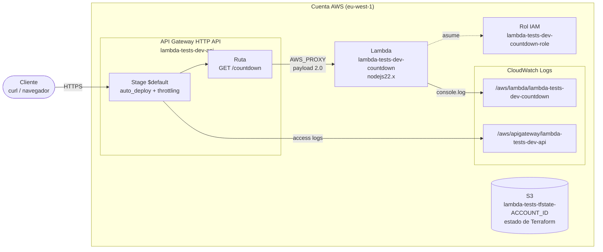
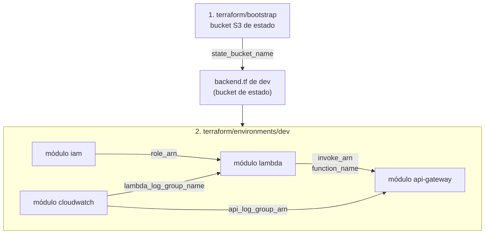

# Infraestructura Terraform: Lambda "countdown" + API Gateway

Despliega la función [`lambda/index.js`](../lambda/index.js) en AWS Lambda y la publica por HTTPS en `GET /countdown` mediante un API Gateway HTTP API. La función devuelve en JSON el tiempo que falta para Año Nuevo.

> **Entorno de trabajo:** todos los comandos de este documento se ejecutan en la **consola Linux Ubuntu de WSL**, dentro de `~/Lambda-Tests`. No uses PowerShell ni CMD, ni abras el proyecto por la ruta `\\wsl.localhost\...` para ejecutar Terraform (ver [Problemas frecuentes](#problemas-frecuentes)).

## Contenido

1. [Arquitectura](#arquitectura)
2. [Estructura de directorios](#estructura-de-directorios)
3. [Convenciones comunes](#convenciones-comunes)
4. [Dependencias y orden de despliegue](#dependencias-y-orden-de-despliegue)
5. [Probar sin desplegar nada](#probar-sin-desplegar-nada)
6. [Guía de despliegue paso a paso](#guía-de-despliegue-paso-a-paso)
7. [Cómo destruir todo](#cómo-destruir-todo)
8. [Costes en AWS](#costes-en-aws)
9. [Seguridad](#seguridad)
10. [Pendientes conocidos](#pendientes-conocidos)
11. [Problemas frecuentes](#problemas-frecuentes)
12. [Documentación de los módulos](#documentación-de-los-módulos)

## Arquitectura



- **Sin VPC.** La función no accede a recursos privados, así que corre en la red gestionada por AWS. No hacen falta subredes ni NAT, y por tanto no hay coste fijo.
- **HTTP API (v2)** en lugar de REST API (v1): es más barata, necesita menos recursos y basta para una integración proxy con Lambda.
- El bucket S3 solo guarda el **estado de Terraform**. La aplicación no lo usa.

## Estructura de directorios

```
Lambda-Tests/
├── lambda/
│   └── index.js                 # código de la función
└── terraform/
    ├── README.md                # este documento
    ├── bootstrap/               # stack independiente (estado local): crea el bucket de estado
    │   ├── README.md
    │   ├── main.tf              # recursos S3 definidos directamente (sin módulo)
    │   ├── outputs.tf           # state_bucket_name, state_bucket_arn
    │   ├── variables.tf         # region, project, force_destroy
    │   └── versions.tf          # incluye el provider aws
    ├── environments/
    │   └── dev/                 # stack del entorno dev (estado en S3)
    │       ├── backend.tf       # backend "s3" con use_lockfile
    │       ├── main.tf          # compone los módulos
    │       ├── outputs.tf       # api_url, lambda_function_name, lambda_log_group
    │       ├── providers.tf     # provider aws + default_tags
    │       ├── terraform.tfvars # region, project, environment
    │       ├── variables.tf
    │       └── versions.tf
    └── modules/
        ├── iam/                 # rol de ejecución de la Lambda
        ├── cloudwatch/          # log groups de Lambda y API
        ├── lambda/              # empaquetado zip + función
        └── api-gateway/         # HTTP API, integración, ruta, stage, permiso
```

## Convenciones comunes

| Tema | Convención |
|---|---|
| Nombres de recursos | `<project>-<environment>-<componente>`. Ejemplos: `lambda-tests-dev-countdown`, `lambda-tests-dev-countdown-role`, `lambda-tests-dev-api`. Se calculan en `locals` de [`environments/dev/main.tf`](environments/dev/main.tf). |
| Bucket de estado | `<project>-tfstate-<account_id>`. El ID de cuenta garantiza que el nombre sea único en todo S3. |
| Log groups | `/aws/lambda/<función>` y `/aws/apigateway/<api>`. |
| Estructura de módulo | `main.tf` (recursos), `variables.tf` (entradas), `outputs.tf` (salidas) y `README.md`. |
| Módulos y stacks | Los entornos (`environments/<env>`) componen módulos de `modules/`. La excepción es `bootstrap/`, que define sus 4 recursos S3 directamente porque tienen un único uso. |
| Providers | Los módulos **no** declaran bloque `provider`: lo heredan del stack que los llama (`environments/<env>` o `bootstrap`). |
| Etiquetas | Se aplican con `default_tags` del provider: `Project`, `Environment` (solo en entornos) y `ManagedBy = terraform`. Los módulos no repiten tags. |
| Versiones | Terraform `>= 1.10` (necesario para `use_lockfile`), provider `hashicorp/aws ~> 6.0` y `hashicorp/archive ~> 2.7`. Los `.terraform.lock.hcl` se suben a git. |
| Estado | Una clave por entorno, `<env>/terraform.tfstate`, en el bucket de bootstrap. El bloqueo usa un archivo `.tflock` en S3, sin DynamoDB. |
| Idioma | Las descripciones de variables y los comentarios están en español. |
| Formato | `terraform fmt -recursive` antes de cada commit. |

## Dependencias y orden de despliegue



**Orden:**

1. `terraform/bootstrap`: se aplica **una sola vez** por cuenta y crea el bucket de estado.
2. `terraform/environments/dev`: un solo `apply`. Terraform calcula el orden interno a partir de las referencias:
   1. `iam` y `cloudwatch`, en paralelo.
   2. `lambda`, que necesita el rol y el log group.
   3. `api-gateway`, que necesita el `invoke_arn` y el nombre de la función.

| Output (módulo origen) | Input (módulo destino) |
|---|---|
| `iam.role_arn` | `lambda.role_arn` |
| `cloudwatch.lambda_log_group_name` | `lambda.log_group_name` |
| `cloudwatch.api_log_group_arn` | `api_gateway.log_group_arn` |
| `lambda.invoke_arn` | `api_gateway.lambda_invoke_arn` |
| `lambda.function_name` | `api_gateway.lambda_function_name` |
| `bootstrap.state_bucket_name` | `bucket` en `environments/dev/backend.tf` (se copia a mano) |

La dependencia `lambda → log group` es **implícita**: el módulo lambda usa el nombre del log group en `logging_config`, así que Terraform crea el log group primero. Si no fuese así, Lambda crearía el log group por su cuenta al primer `console.log`, sin retención, y el siguiente `apply` fallaría con un conflicto.

## Probar sin desplegar nada

Ninguno de estos pasos crea recursos en AWS.

```bash
cd ~/Lambda-Tests/terraform

# 1. Formato (no modifica nada con -check)
terraform fmt -recursive -check -diff

# 2. Sintaxis y tipos, sin backend ni credenciales
(cd bootstrap        && terraform init -backend=false -input=false && terraform validate)
(cd environments/dev && terraform init -backend=false -input=false && terraform validate)
```

**Ejecutar la función en local** (requiere Node.js, ver [requisitos](#1-requisitos-en-ubuntu-wsl)):

```bash
cd ~/Lambda-Tests
node -e 'require("./lambda/index.js").handler({}).then(r => console.log(JSON.stringify(r, null, 2)))'
```

**Ver el plan** (solo lectura, pero necesita credenciales AWS y, en `dev`, que el bucket de estado ya exista):

```bash
cd ~/Lambda-Tests/terraform/bootstrap && terraform init && terraform plan
cd ~/Lambda-Tests/terraform/environments/dev && terraform init && terraform plan
```

**Análisis estático opcional** (no viene instalado):

```bash
tflint --recursive                    # buenas prácticas y errores del provider
checkov -d ~/Lambda-Tests/terraform   # reglas de seguridad
trivy config ~/Lambda-Tests/terraform # alternativa a checkov
```

## Guía de despliegue paso a paso

### 1. Requisitos en Ubuntu (WSL)

```bash
# Herramientas base
sudo apt-get update && sudo apt-get install -y curl unzip gnupg lsb-release

# Terraform (repositorio oficial de HashiCorp)
curl -fsSL https://apt.releases.hashicorp.com/gpg | sudo gpg --dearmor -o /usr/share/keyrings/hashicorp-archive-keyring.gpg
echo "deb [signed-by=/usr/share/keyrings/hashicorp-archive-keyring.gpg] https://apt.releases.hashicorp.com $(lsb_release -cs) main" \
  | sudo tee /etc/apt/sources.list.d/hashicorp.list
sudo apt-get update && sudo apt-get install -y terraform

# AWS CLI v2
curl -fsSL "https://awscli.amazonaws.com/awscli-exe-linux-x86_64.zip" -o /tmp/awscliv2.zip
unzip -q /tmp/awscliv2.zip -d /tmp && sudo /tmp/aws/install --update

# Node.js (opcional, solo para probar la función en local)
sudo apt-get install -y nodejs

terraform version   # >= 1.10
aws --version       # aws-cli/2.x
```

### 2. Credenciales AWS (dentro de Ubuntu)

Las credenciales se guardan en `~/.aws` **de Ubuntu**. Las que tengas configuradas en Windows no se ven desde WSL.

```bash
aws configure          # claves de acceso de un usuario IAM
# o bien
aws configure sso      # IAM Identity Center (recomendado)
export AWS_PROFILE=<perfil>   # si no usas el perfil "default"

aws sts get-caller-identity   # comprueba la cuenta y la identidad ANTES de desplegar
```

La identidad necesita permisos sobre **S3, IAM (roles), Lambda, API Gateway y CloudWatch Logs**.

### 3. Crear el bucket de estado (una sola vez)

```bash
cd ~/Lambda-Tests/terraform/bootstrap
terraform init
terraform plan
terraform apply
terraform output -raw state_bucket_name   # p. ej. lambda-tests-tfstate-123456789012
```

El estado de este stack queda en `bootstrap/terraform.tfstate`, en local. Guárdalo bien: está en `.gitignore` y no se sube a git.

### 4. Configurar el backend de dev

Sustituye el placeholder de [`environments/dev/backend.tf`](environments/dev/backend.tf) por el nombre que devolvió el paso anterior:

```bash
cd ~/Lambda-Tests/terraform
BUCKET=$(terraform -chdir=bootstrap output -raw state_bucket_name)
sed -i "s/lambda-tests-tfstate-<ACCOUNT_ID>/${BUCKET}/" environments/dev/backend.tf
grep bucket environments/dev/backend.tf
```

Si has cambiado la región, ajústala en `bootstrap/variables.tf`, `environments/dev/terraform.tfvars` **y** `environments/dev/backend.tf`.

### 5. Desplegar dev

```bash
cd ~/Lambda-Tests/terraform/environments/dev
terraform init -reconfigure
terraform plan -out=tfplan
terraform apply tfplan
```

### 6. Verificar

```bash
curl -s "$(terraform output -raw api_url)"; echo
# {"target_year":2027,"time_remaining":{...},"message":"Faltan ... para Año Nuevo 🎉"}

aws logs tail "$(terraform output -raw lambda_log_group)" --since 10m
aws logs tail /aws/apigateway/lambda-tests-dev-api --since 10m

terraform plan   # debe decir "No changes"
```

### 7. Actualizar el código

Edita `lambda/index.js` y vuelve a ejecutar `terraform apply` en `environments/dev`. El zip se regenera y, al cambiar `source_code_hash`, Terraform sube la nueva versión. No hace falta ningún paso manual.

## Cómo destruir todo

El orden es el inverso al del despliegue: primero el entorno y después el bucket de estado.

```bash
# 1. Entorno dev: Lambda, API, rol y logs
cd ~/Lambda-Tests/terraform/environments/dev
terraform destroy

# 2. Bucket de estado. Está versionado y force_destroy = false, así que
#    Terraform no lo borra mientras tenga objetos o versiones antiguas.
#    Activa force_destroy solo para esta operación:
cd ~/Lambda-Tests/terraform/bootstrap
terraform apply   -var force_destroy=true   # solo cambia el atributo force_destroy
terraform destroy -var force_destroy=true   # borra el bucket con todas sus versiones

# 3. Limpieza local
cd ~/Lambda-Tests/terraform
rm -rf bootstrap/.terraform bootstrap/terraform.tfstate* \
       environments/dev/.terraform environments/dev/build environments/dev/tfplan
```

> ⚠️ Destruir el bucket elimina el estado de **todos** los entornos que lo usen. Hazlo solo después de destruir esos entornos.

## Costes en AWS

Precios de referencia en **eu-west-1**, en USD. Pueden cambiar: compruébalos en la [calculadora de AWS](https://calculator.aws/).

| Servicio | Tarifa | Capa gratuita | Notas |
|---|---|---|---|
| Lambda: peticiones | $0,20 por millón | 1 M/mes (permanente) | |
| Lambda: cómputo | $0,0000166667 por GB-s | 400 000 GB-s/mes (permanente) | 128 MB × ~10 ms por llamada |
| API Gateway HTTP API | $1,00 por millón (primeros 300 M) | 1 M/mes los primeros 12 meses | |
| CloudWatch Logs: ingesta | ~$0,57 por GB | 5 GB/mes | ~0,7 KB por llamada (logs de Lambda + access log) |
| CloudWatch Logs: almacenamiento | $0,03 por GB-mes | 5 GB | Retención de 14 días |
| S3 (estado) | ~$0,023 por GB-mes + peticiones | 5 GB los primeros 12 meses | Unos KB, céntimos al mes |
| IAM | Gratis | | |

**Estimación mensual:**

| Tráfico | Lambda | API Gateway | Logs | Total aprox. |
|---|---|---|---|---|
| 100 000 peticiones | $0 | $0 – $0,10 | $0 | **< $0,15** |
| 10 M peticiones | ~$1,80 | ~$10 | ~$1,50 – $4 | **~$14 – $16** |

No hay costes fijos: sin VPC, sin NAT Gateway y sin instancias. Si no hay tráfico, el coste es prácticamente $0. Para no llevarte sorpresas, crea un **AWS Budget** con alerta (por ejemplo, de $5/mes).

## Seguridad

**Lo que ya está implementado:**

- **Mínimo privilegio:** el rol de la Lambda solo tiene `AWSLambdaBasicExecutionRole`, es decir, permiso para escribir sus logs.
- **Permiso de invocación acotado:** `aws_lambda_permission` solo deja invocar la función al API de este stack (`source_arn = <execution_arn>/*/*`).
- **Bucket de estado:** cifrado SSE-S3, versionado (permite recuperar estados anteriores) y bloqueo total de acceso público.
- **Throttling** en el stage (100 peticiones/s y ráfaga de 50), que limita abusos y el coste.
- **Access logs** del API en CloudWatch, para auditar las peticiones.

**Riesgos y recomendaciones:**

- **El API es público y no tiene autenticación.** Cualquiera con la URL puede invocarlo. Opciones:
  - JWT authorizer con Cognito u otro IdP OIDC (`aws_apigatewayv2_authorizer`).
  - Autorización IAM (`authorization_type = "AWS_IAM"` en la ruta) con firma SigV4.
  - Lambda authorizer, para lógica propia (API keys, cabeceras).
  - Los HTTP API no admiten WAF directamente. Si lo necesitas, pon CloudFront con WAF delante.
- **El estado de Terraform puede contener datos sensibles.** No lo subas a git (`.gitignore` ya lo excluye) y restringe quién puede leer el bucket.
- Usa **credenciales temporales** (SSO o roles), no claves de acceso de larga duración.
- No guardes secretos en `environment_variables` de la Lambda. Usa Secrets Manager o SSM Parameter Store.

## Pendientes conocidos

- `environments/dev/backend.tf` tiene un **placeholder** (`<ACCOUNT_ID>`) que hay que sustituir a mano tras el bootstrap.
- La **región está repetida** en tres sitios (`bootstrap/variables.tf`, `dev/terraform.tfvars`, `dev/backend.tf`). Los backends no admiten variables. Se podría usar `-backend-config=backend.hcl`.
- El estado de **bootstrap es local**. Si se pierde, habría que importar el bucket (`terraform import aws_s3_bucket.state <bucket>`, ver [bootstrap/README.md](bootstrap/README.md#problemas-frecuentes)).
- El API no tiene **autenticación** (ver [Seguridad](#seguridad)).
- No hay **CI/CD**. Lo siguiente sería GitHub Actions con OIDC (`aws_iam_openid_connect_provider`) en lugar de claves.
- Solo existe el entorno **dev**. Para `prod` basta copiar `environments/dev` y cambiar `environment` y `key`.
- No hay **dominio propio** (ACM + Route 53 + `aws_apigatewayv2_domain_name`).
- No hay **alarmas** (errores, throttles, latencia) ni trazas **X-Ray**.
- No hay **tests automatizados** de la función ni de la infraestructura (`terraform test`).

## Problemas frecuentes

| Síntoma | Causa | Solución |
|---|---|---|
| `terraform init` en dev falla con `NoSuchBucket` o un nombre de bucket inválido | `backend.tf` aún tiene `<ACCOUNT_ID>`, o no se ha aplicado bootstrap | Sigue los pasos [3](#3-crear-el-bucket-de-estado-una-sola-vez) y [4](#4-configurar-el-backend-de-dev). Después, `terraform init -reconfigure`. |
| `BucketAlreadyExists` en bootstrap | Ese nombre ya existe en otra cuenta | Cambia `project` en `bootstrap/variables.tf`. |
| `ResourceAlreadyExistsException` al crear un log group | La Lambda se ejecutó antes de que Terraform creara su log group (despliegue manual previo o `destroy` interrumpido) | `terraform import module.cloudwatch.aws_cloudwatch_log_group.lambda /aws/lambda/lambda-tests-dev-countdown`, o bórralo con `aws logs delete-log-group`. |
| `{"message":"Not Found"}` | Ruta o método incorrectos | Usa `GET` sobre `<api_url>` (que ya incluye `/countdown`). |
| `{"message":"Internal Server Error"}` | La función lanzó un error o falta el permiso de invocación | Revisa `aws logs tail /aws/lambda/lambda-tests-dev-countdown` y los access logs (`integrationErr`). Si es el permiso, `terraform apply`. |
| `ExpiredToken`, `AccessDenied` o `no valid credential sources` | La sesión SSO caducó, el perfil es incorrecto o faltan permisos | `aws sso login --profile <perfil>`, revisa `AWS_PROFILE` y `aws sts get-caller-identity`. |
| `SignatureDoesNotMatch` o `RequestTimeTooSkewed` | El reloj de WSL se ha desfasado (pasa al suspender el equipo) | `sudo hwclock -s` o `wsl --shutdown` y vuelve a abrir Ubuntu. |
| `Error acquiring the state lock` | Una ejecución anterior se interrumpió y dejó el `.tflock` | Comprueba que nadie más está aplicando y ejecuta `terraform force-unlock <LOCK_ID>`. |
| Terraform muy lento, errores de permisos o `\r` en scripts | Se ejecuta desde PowerShell/CMD o sobre la ruta `\\wsl.localhost\...` | Trabaja siempre en la consola Ubuntu, en `~/Lambda-Tests`. |
| Las credenciales de Windows no funcionan | WSL no lee `C:\Users\<usuario>\.aws` | Configúralas en Ubuntu con `aws configure` (o enlaza `~/.aws` a la carpeta de Windows, bajo tu responsabilidad). |
| `BucketNotEmpty` al destruir bootstrap | Bucket versionado con `force_destroy = false` | Usa `-var force_destroy=true` (ver [Cómo destruir todo](#cómo-destruir-todo)). |
| Al cambiar el código no se actualiza la función | Has editado otro directorio o no se ha aplicado | El zip sale de `~/Lambda-Tests/lambda`. Ejecuta `terraform apply` en `environments/dev`. |

## Documentación de los módulos

El stack que crea el bucket de estado está documentado en [bootstrap/README.md](bootstrap/README.md).

| Módulo | Descripción |
|---|---|
| [iam](modules/iam/README.md) | Rol de ejecución de la Lambda |
| [cloudwatch](modules/cloudwatch/README.md) | Log groups de la Lambda y del API |
| [lambda](modules/lambda/README.md) | Empaquetado y función Lambda |
| [api-gateway](modules/api-gateway/README.md) | HTTP API, ruta, stage y permiso de invocación |
