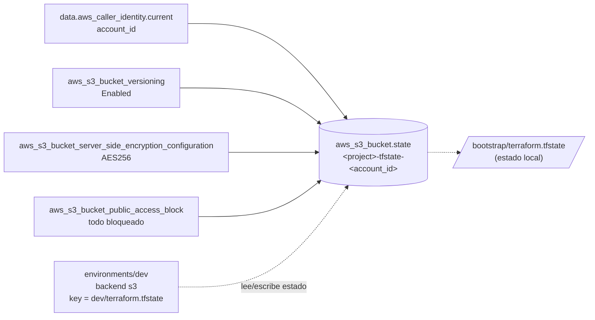

# Stack `bootstrap`

Crea el bucket S3 donde Terraform guarda el estado remoto de los entornos (`environments/*`). Es un stack independiente con **estado local**, porque el bucket todavía no existe cuando se aplica por primera vez. Se aplica **una sola vez por cuenta**.

A diferencia de `environments/dev`, no usa módulos: son 4 recursos con un único uso, y definirlos aquí directamente evita una indirección innecesaria.

← [Volver a la documentación general](../README.md)

## Diagrama



## Recursos

| Recurso | Propósito |
|---|---|
| `data.aws_caller_identity.current` | Obtiene el ID de cuenta para que el nombre del bucket sea único |
| `aws_s3_bucket.state` | Bucket del estado |
| `aws_s3_bucket_versioning.state` | Guarda versiones anteriores del estado, para recuperarlo si se corrompe o se borra |
| `aws_s3_bucket_server_side_encryption_configuration.state` | Cifrado en reposo SSE-S3 (AES256) |
| `aws_s3_bucket_public_access_block.state` | Bloquea cualquier acceso público |

## Variables

| Nombre | Tipo | Default | Descripción |
|---|---|---|---|
| `region` | `string` | `"eu-west-1"` | Región AWS. Debe coincidir con la de `environments/*/backend.tf`. |
| `project` | `string` | `"lambda-tests"` | Prefijo del nombre del bucket |
| `force_destroy` | `bool` | `false` | Permite borrar el bucket aunque contenga objetos o versiones. Actívalo solo para destruirlo. |

## Outputs

| Nombre | Descripción |
|---|---|
| `state_bucket_name` | Nombre del bucket. Se copia en `backend.tf` de cada entorno. |
| `state_bucket_arn` | ARN del bucket, útil para políticas IAM de acceso al estado |

## Uso

```bash
cd ~/Lambda-Tests/terraform/bootstrap
terraform init
terraform apply
terraform output -raw state_bucket_name   # p. ej. lambda-tests-tfstate-123456789012
```

El siguiente paso es copiar ese nombre en `environments/dev/backend.tf` (ver la [guía de despliegue](../README.md#4-configurar-el-backend-de-dev)).

Destruirlo, **solo después** de destruir todos los entornos:

```bash
terraform apply   -var force_destroy=true   # solo cambia el atributo force_destroy
terraform destroy -var force_destroy=true   # borra el bucket con todas sus versiones
```

## Notas

- **Sin DynamoDB:** desde Terraform 1.10 el backend S3 admite `use_lockfile = true`, que bloquea el estado con un archivo `.tflock` dentro del propio bucket.
- **`force_destroy = false` por defecto**, para que un `terraform destroy` accidental no borre el estado de todos los entornos.
- **El estado local** (`terraform.tfstate`) está en `.gitignore`. Guárdalo bien: si se pierde, hay que importar los recursos (ver [Problemas frecuentes](#problemas-frecuentes)).
- **Coste:** céntimos al mes.

## Seguridad

- El estado puede contener valores sensibles. Limita `s3:GetObject` y `s3:PutObject` en este bucket a quienes despliegan, usando `state_bucket_arn`.
- Mejoras posibles: cifrado con una clave KMS propia (`sse_algorithm = "aws:kms"`), una política de bucket que exija TLS (`aws:SecureTransport`) y una regla de ciclo de vida para expirar versiones antiguas.

## Problemas frecuentes

| Síntoma | Solución |
|---|---|
| `BucketAlreadyExists` | El nombre ya existe en otra cuenta. Cambia `project`. |
| `BucketNotEmpty` al destruir | Usa `-var force_destroy=true` (primero `apply`, después `destroy`). |
| Se perdió `bootstrap/terraform.tfstate` | `terraform import aws_s3_bucket.state <bucket>` y lo mismo con `aws_s3_bucket_versioning.state`, `aws_s3_bucket_server_side_encryption_configuration.state` y `aws_s3_bucket_public_access_block.state`, usando el nombre del bucket como ID. |
