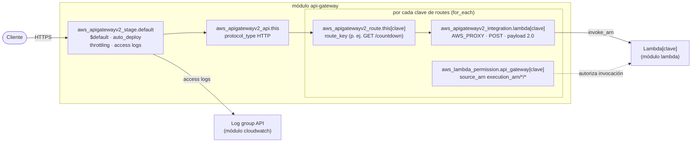

# Módulo `api-gateway`

Crea **un único API Gateway HTTP API (v2)** compartido por todas las funciones del entorno y publica cada Lambda en su propia ruta. Por cada entrada de `routes` crea una integración proxy, una ruta y el permiso de invocación. El stage `$default`, con access logs y throttling, es común.

← [Volver a la documentación general](../../README.md)

## Estructura de directorios

```
terraform/modules/api-gateway/
├── main.tf        # aws_apigatewayv2_api.this y aws_apigatewayv2_stage.default (compartidos);
│                  # aws_apigatewayv2_integration.lambda, aws_apigatewayv2_route.this y
│                  # aws_lambda_permission.api_gateway (uno por clave, for_each = routes)
├── variables.tf   # api_name, routes, log_group_arn, throttling_burst_limit, throttling_rate_limit
├── outputs.tf     # api_id, api_endpoint
└── README.md      # este documento
```

Lo llama `module "api_gateway"` en [`environments/dev/main.tf`](../../environments/dev/main.tf).

## Diagrama



## Recursos

| Recurso | Cantidad | Propósito |
|---|---|---|
| `aws_apigatewayv2_api.this` | 1 | El HTTP API. Expone `api_endpoint` (`https://<id>.execute-api.<region>.amazonaws.com`). |
| `aws_apigatewayv2_stage.default` | 1 | Stage `$default` (sin prefijo en la URL), con despliegue automático, access logs y throttling |
| `aws_apigatewayv2_integration.lambda[clave]` | 1 por ruta | Integración proxy con la Lambda (payload 2.0) |
| `aws_apigatewayv2_route.this[clave]` | 1 por ruta | Ruta pública, por ejemplo `GET /countdown` |
| `aws_lambda_permission.api_gateway[clave]` | 1 por ruta | Permite a este API, y solo a este, invocar la función |

## Inputs

| Nombre | Tipo | Default | Descripción |
|---|---|---|---|
| `api_name` | `string` | — (obligatorio) | Nombre del HTTP API |
| `routes` | `map(object({ route_key = string, lambda_invoke_arn = string, lambda_function_name = string }))` | — (obligatorio) | Una entrada por función. La clave es el nombre lógico (`countdown`, `birthday`). Los `route_key` no se pueden repetir (hay validación). |
| `log_group_arn` | `string` | — (obligatorio) | ARN del log group para access logs |
| `throttling_burst_limit` | `number` | `50` | Ráfaga máxima de peticiones simultáneas (para todo el stage) |
| `throttling_rate_limit` | `number` | `100` | Peticiones por segundo sostenidas (para todo el stage) |

## Outputs

| Nombre | Descripción |
|---|---|
| `api_id` | ID del API |
| `api_endpoint` | URL base del API. El entorno le añade la ruta de cada función en su output `api_urls`. |

## Dependencias

- **Recibe de:** [`lambda`](../lambda/README.md) (`invoke_arn`, `function_name` de cada instancia) y [`cloudwatch`](../cloudwatch/README.md) (`api_log_group_arn`).
- **Alimenta a:** los outputs `api_endpoint` y `api_urls` del entorno.

## Ejemplo de uso

El entorno construye `routes` a partir del mapa `lambdas` de `terraform.tfvars`:

```hcl
module "api_gateway" {
  source = "../../modules/api-gateway"

  api_name      = local.api_name                       # lambda-tests-dev-api
  log_group_arn = module.cloudwatch.api_log_group_arn

  routes = {
    for k, cfg in var.lambdas : k => {
      route_key            = cfg.route_key              # "GET /countdown"
      lambda_invoke_arn    = module.lambda[k].invoke_arn
      lambda_function_name = module.lambda[k].function_name
    }
  }
}
```

Probar desde la consola Ubuntu de WSL:

```bash
cd ~/Lambda-Tests/terraform/environments/dev
terraform output api_urls
curl -i "$(terraform output -raw api_endpoint)/countdown"
curl -i "$(terraform output -raw api_endpoint)/birthday"
```

## Notas

- **Un API para todas las funciones:** todas comparten dominio, stage, throttling y access logs. Cada función solo añade 3 recursos aquí (integración, ruta y permiso).
- **HTTP API frente a REST API:** el HTTP API cuesta unas 3,5 veces menos ($1,00 frente a $3,50 por millón), tiene menos latencia y necesita menos recursos (no hacen falta `deployment` ni `method` explícitos). A cambio no tiene API keys/usage plans, WAF directo ni validación de peticiones.
- **Payload 2.0:** el evento que recibe la Lambda trae `rawPath`, `routeKey`, `requestContext.http.method`, `queryStringParameters`, `pathParameters`, etc. La respuesta `{ statusCode, headers, body }` del handler es compatible.
- **`$default` + `auto_deploy`:** cualquier cambio en rutas o integraciones se publica solo, sin recurso `aws_apigatewayv2_deployment`.
- **El permiso de invocación vive aquí**, y no en el módulo lambda, porque necesita el `execution_arn` del API. Así no hay dependencia circular.
- **`route_key`** admite `"<MÉTODO> /ruta"`, parámetros (`"GET /items/{id}"`), comodines (`"ANY /proxy/{proxy+}"`) y `"$default"`.

## Seguridad

- **Las rutas son públicas, sin autenticación** (`authorization_type` por defecto `NONE`). Opciones:
  - JWT authorizer (Cognito u otro IdP OIDC): `aws_apigatewayv2_authorizer` con `authorizer_type = "JWT"`, y en la ruta `authorization_type = "JWT"`.
  - IAM: `authorization_type = "AWS_IAM"`. El cliente firma con SigV4.
  - Lambda authorizer para lógica propia.
- **Throttling** limita abusos y el coste ante picos o ataques. Es común para todas las rutas.
- **WAF** no se puede asociar a un HTTP API. Si lo necesitas, pon CloudFront con WAF delante, o pasa a REST API.
- `source_arn = <execution_arn>/*/*` hace que solo este API pueda invocar cada función. Para restringirlo a su ruta, usa `/*/GET/countdown`.
- **CORS:** no está configurado. Si un frontend en otro dominio va a llamar al API, añade `cors_configuration` en `aws_apigatewayv2_api`.

## Problemas frecuentes

| Síntoma | Solución |
|---|---|
| `{"message":"Not Found"}` | El método o la ruta no coinciden con ningún `route_key`. Revisa `terraform output api_urls`. |
| `{"message":"Internal Server Error"}` | Error en la Lambda o falta el permiso. Revisa `integrationErr` en `aws logs tail /aws/apigateway/lambda-tests-dev-api` y los logs de la función. |
| `{"message":"Too Many Requests"}` (429) | Has superado el throttling. Sube `throttling_rate_limit` o `throttling_burst_limit`. |
| `ConflictException: Route with key ... already exists` | Dos funciones con el mismo `route_key`. La validación lo detecta en `plan`; cambia uno de ellos. |
| Error de CORS en el navegador | Añade `cors_configuration` con los orígenes permitidos. |
