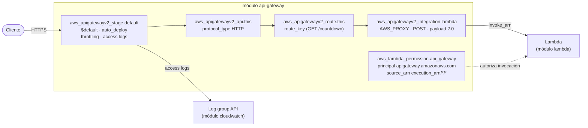

# Módulo `api-gateway`

Publica la función Lambda por HTTPS con un **API Gateway HTTP API (v2)**: integración proxy, una ruta, el stage `$default` con access logs y throttling, y el permiso para que el API invoque la función.

← [Volver a la documentación general](../../README.md)

## Diagrama



## Recursos

| Recurso | Propósito |
|---|---|
| `aws_apigatewayv2_api.this` | El HTTP API. Expone `api_endpoint` (`https://<id>.execute-api.<region>.amazonaws.com`). |
| `aws_apigatewayv2_integration.lambda` | Integración proxy con la Lambda (payload 2.0) |
| `aws_apigatewayv2_route.this` | Ruta pública, por ejemplo `GET /countdown` |
| `aws_apigatewayv2_stage.default` | Stage `$default` (sin prefijo en la URL), con despliegue automático, access logs y throttling |
| `aws_lambda_permission.api_gateway` | Permite al API, y solo a este API, invocar la función |

## Inputs

| Nombre | Tipo | Default | Descripción |
|---|---|---|---|
| `api_name` | `string` | — (obligatorio) | Nombre del HTTP API |
| `lambda_invoke_arn` | `string` | — (obligatorio) | Invoke ARN de la Lambda a integrar |
| `lambda_function_name` | `string` | — (obligatorio) | Nombre de la Lambda (para el permiso de invocación) |
| `route_key` | `string` | — (obligatorio) | Ruta expuesta, p. ej. `"GET /countdown"` |
| `log_group_arn` | `string` | — (obligatorio) | ARN del log group para access logs |
| `throttling_burst_limit` | `number` | `50` | Ráfaga máxima de peticiones simultáneas |
| `throttling_rate_limit` | `number` | `100` | Peticiones por segundo sostenidas |

## Outputs

| Nombre | Descripción |
|---|---|
| `api_id` | ID del API |
| `api_endpoint` | URL base del API. El entorno añade `/countdown` en su output `api_url`. |

## Dependencias

- **Recibe de:** [`lambda`](../lambda/README.md) (`invoke_arn`, `function_name`) y [`cloudwatch`](../cloudwatch/README.md) (`api_log_group_arn`).
- **Alimenta a:** el output `api_url` del entorno.

## Ejemplo de uso

```hcl
module "api_gateway" {
  source = "../../modules/api-gateway"

  api_name             = local.api_name          # lambda-tests-dev-api
  route_key            = "GET /countdown"
  lambda_invoke_arn    = module.lambda.invoke_arn
  lambda_function_name = module.lambda.function_name
  log_group_arn        = module.cloudwatch.api_log_group_arn
}
```

Probar desde Ubuntu:

```bash
cd ~/Lambda-Tests/terraform/environments/dev
curl -i "$(terraform output -raw api_url)"
```

## Notas

- **HTTP API frente a REST API:** el HTTP API cuesta unas 3,5 veces menos ($1,00 frente a $3,50 por millón), tiene menos latencia y necesita menos recursos (no hacen falta `deployment` ni `method` explícitos). A cambio no tiene API keys/usage plans, WAF directo ni validación de peticiones. Si necesitas eso, usa REST API.
- **Payload 2.0:** el evento que recibe la Lambda trae `rawPath`, `requestContext.http.method`, etc. La respuesta `{ statusCode, headers, body }` del handler es compatible.
- **`$default` + `auto_deploy`:** cualquier cambio en rutas o integraciones se publica solo, sin recurso `aws_apigatewayv2_deployment`.
- **El permiso de invocación vive aquí**, y no en el módulo lambda, porque necesita el `execution_arn` del API. Así no hay dependencia circular.
- **Añadir más rutas:** convierte `route_key` en una lista y usa `for_each` en `aws_apigatewayv2_route`. Con la misma integración, la Lambda puede distinguir las rutas por `event.routeKey`.

## Seguridad

- **La ruta es pública, sin autenticación** (`authorization_type` por defecto `NONE`). Opciones:
  - JWT authorizer (Cognito u otro IdP OIDC): `aws_apigatewayv2_authorizer` con `authorizer_type = "JWT"`, y en la ruta `authorization_type = "JWT"`.
  - IAM: `authorization_type = "AWS_IAM"`. El cliente firma con SigV4.
  - Lambda authorizer para lógica propia.
- **Throttling** limita abusos y el coste ante picos o ataques. Ajústalo al tráfico real.
- **WAF** no se puede asociar a un HTTP API. Si lo necesitas, pon CloudFront con WAF delante, o pasa a REST API.
- `source_arn = <execution_arn>/*/*` hace que solo este API pueda invocar la función. Para restringirlo más, usa `/*/GET/countdown`.
- **CORS:** no está configurado. Si un frontend en otro dominio va a llamar al API, añade `cors_configuration` en `aws_apigatewayv2_api`.

## Problemas frecuentes

| Síntoma | Solución |
|---|---|
| `{"message":"Not Found"}` | El método o la ruta no coinciden con `route_key`. Usa `GET /countdown`. |
| `{"message":"Internal Server Error"}` | Error en la Lambda o falta el permiso. Revisa `integrationErr` en `aws logs tail /aws/apigateway/lambda-tests-dev-api` y los logs de la función. |
| `{"message":"Too Many Requests"}` (429) | Has superado el throttling. Sube `throttling_rate_limit` o `throttling_burst_limit`. |
| `BadRequestException: Insufficient permissions to enable logging` | Falta el rol de CloudWatch a nivel de cuenta para API Gateway. Pasa sobre todo con REST API. En HTTP API, comprueba que `log_group_arn` es correcto y existe. |
| Error de CORS en el navegador | Añade `cors_configuration` con los orígenes permitidos. |
