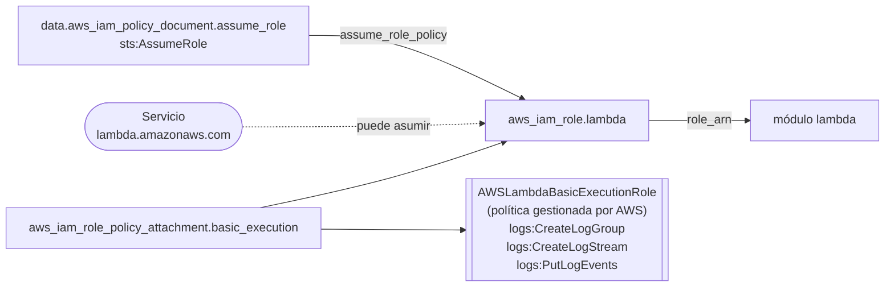

# Módulo `iam`

Crea el **rol de ejecución** que asume la función Lambda. Solo concede permiso para escribir logs en CloudWatch.

← [Volver a la documentación general](../../README.md)

## Diagrama



## Recursos

| Recurso | Propósito |
|---|---|
| `data.aws_iam_policy_document.assume_role` | Trust policy: solo el servicio Lambda puede asumir el rol |
| `aws_iam_role.lambda` | Rol de ejecución |
| `aws_iam_role_policy_attachment.basic_execution` | Adjunta `AWSLambdaBasicExecutionRole` (escritura de logs) |

## Inputs

| Nombre | Tipo | Default | Descripción |
|---|---|---|---|
| `role_name` | `string` | — (obligatorio) | Nombre del rol de ejecución de la Lambda |

## Outputs

| Nombre | Descripción |
|---|---|
| `role_arn` | ARN del rol. Es la entrada `role_arn` del módulo `lambda`. |
| `role_name` | Nombre del rol, para adjuntarle políticas adicionales desde fuera |

## Dependencias

- **Recibe de:** nada.
- **Alimenta a:** [`lambda`](../lambda/README.md) (`role_arn`).

## Ejemplo de uso

```hcl
module "iam" {
  source = "../../modules/iam"

  role_name = "${local.function_name}-role"   # lambda-tests-dev-countdown-role
}
```

## Notas

- **Ampliar permisos:** si la función tiene que acceder a otros servicios (DynamoDB, S3, Secrets Manager), añade una política en línea **acotada a recursos concretos** usando el output `role_name`:

  ```hcl
  resource "aws_iam_role_policy" "extra" {
    role   = module.iam.role_name
    policy = data.aws_iam_policy_document.extra.json
  }
  ```

- **VPC:** si algún día la Lambda va dentro de una VPC, cambia la política por `AWSLambdaVPCAccessExecutionRole`, que incluye los permisos para crear interfaces de red (ENI).
- **X-Ray:** para activar trazas, adjunta también `AWSXRayDaemonWriteAccess`.

## Seguridad

- Sigue el principio de mínimo privilegio: el rol no puede leer ni modificar nada fuera de CloudWatch Logs.
- `AWSLambdaBasicExecutionRole` permite escribir en **cualquier** log group de la cuenta (`Resource: *`). Para restringirlo, sustitúyela por una política propia limitada a `arn:aws:logs:<region>:<cuenta>:log-group:/aws/lambda/<función>:*`.

## Problemas frecuentes

| Síntoma | Solución |
|---|---|
| `The role defined for the function cannot be assumed by Lambda` al crear la función | IAM tarda unos segundos en propagar el rol nuevo. Repite `terraform apply`. |
| `EntityAlreadyExists` | Ya existe un rol con ese nombre (de un despliegue anterior). Impórtalo con `terraform import module.iam.aws_iam_role.lambda <nombre>` o bórralo. |
| `AccessDenied` en `iam:CreateRole` | La identidad que despliega no tiene permisos de IAM. |
