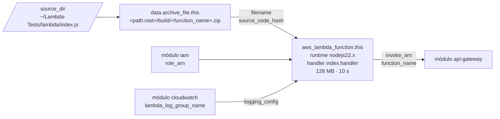

# Módulo `lambda`

Empaqueta un directorio de código en un zip y crea la **función Lambda**. Los logs van al log group creado por el módulo [`cloudwatch`](../cloudwatch/README.md).

← [Volver a la documentación general](../../README.md)

## Diagrama



## Recursos

| Recurso | Propósito |
|---|---|
| `data.archive_file.this` | Genera el zip del código en cada `plan`/`apply` |
| `aws_lambda_function.this` | La función |

## Inputs

| Nombre | Tipo | Default | Descripción |
|---|---|---|---|
| `function_name` | `string` | — (obligatorio) | Nombre de la función Lambda |
| `source_dir` | `string` | — (obligatorio) | Directorio con el código fuente a empaquetar |
| `role_arn` | `string` | — (obligatorio) | ARN del rol de ejecución |
| `log_group_name` | `string` | — (obligatorio) | Log group de CloudWatch donde escribe la función |
| `runtime` | `string` | `"nodejs22.x"` | Runtime de Lambda |
| `handler` | `string` | `"index.handler"` | `<archivo>.<función exportada>` |
| `memory_size` | `number` | `128` | Memoria en MB (128–10240). La CPU escala con la memoria. |
| `timeout` | `number` | `10` | Tiempo máximo de ejecución, en segundos (máx. 900) |
| `environment_variables` | `map(string)` | `{}` | Variables de entorno de la función |

## Outputs

| Nombre | Descripción |
|---|---|
| `function_name` | Nombre de la función, para el permiso de invocación del API |
| `arn` | ARN de la función |
| `invoke_arn` | ARN de invocación, usado como `integration_uri` en API Gateway |

## Dependencias

- **Recibe de:** [`iam`](../iam/README.md) (`role_arn`) y [`cloudwatch`](../cloudwatch/README.md) (`lambda_log_group_name`).
- **Alimenta a:** [`api-gateway`](../api-gateway/README.md) (`invoke_arn`, `function_name`).

## Ejemplo de uso

```hcl
module "lambda" {
  source = "../../modules/lambda"

  function_name  = local.function_name                 # lambda-tests-dev-countdown
  source_dir     = "${path.root}/../../../lambda"      # ~/Lambda-Tests/lambda
  role_arn       = module.iam.role_arn
  log_group_name = module.cloudwatch.lambda_log_group_name
}
```

Probar la función en local antes de desplegar (requiere `sudo apt-get install -y nodejs`):

```bash
cd ~/Lambda-Tests
node -e 'require("./lambda/index.js").handler({}).then(r => console.log(r))'
```

Invocarla directamente en AWS, sin pasar por el API:

```bash
aws lambda invoke --function-name lambda-tests-dev-countdown /tmp/out.json && cat /tmp/out.json
```

## Notas

- **Redespliegue automático:** `source_code_hash` es el hash del zip. Si cambias cualquier archivo de `source_dir`, el siguiente `apply` sube el código nuevo.
- **El zip se escribe en `<stack>/build/`** (por ejemplo, `environments/dev/build/`). Está en `.gitignore`.
- **Dependencias npm:** ahora el código no tiene ninguna. Si añades un `package.json`, ejecuta `npm ci --omit=dev` dentro de `lambda/` antes de `terraform apply`, para que `node_modules` entre en el zip. Si pasa de 50 MB, súbelo a S3 (`s3_bucket` y `s3_key`) o usa una Lambda Layer.
- **Formato de respuesta:** el handler devuelve `{ statusCode, headers, body }`, que es justo lo que espera la integración proxy (payload 2.0) del API Gateway.
- **`logging_config`** además crea la dependencia implícita con el log group, que se crea antes que la función.

## Seguridad

- No pongas secretos en `environment_variables`: se ven en la consola y en el estado de Terraform. Usa Secrets Manager o SSM Parameter Store y da permiso de lectura al rol.
- Mantén el runtime en una versión con soporte. AWS retira los runtimes antiguos (por ejemplo, `nodejs18.x`).
- Mejoras posibles: `reserved_concurrent_executions` para limitar la concurrencia (y el coste) y una dead-letter queue para invocaciones asíncronas.

## Problemas frecuentes

| Síntoma | Solución |
|---|---|
| `Runtime.ImportModuleError: Cannot find module 'index'` | `handler` no coincide con el archivo, o el zip no tiene `index.js` en la raíz. Comprueba `source_dir`. |
| `error archiving directory: could not archive missing directory` | La ruta de `source_dir` es incorrecta. Ejecuta Terraform desde `~/Lambda-Tests/terraform/environments/dev`, dentro de WSL. |
| `Task timed out after 10.00 seconds` | Aumenta `timeout`, o `memory_size` (que da más CPU). |
| `InvalidParameterValueException: The role defined for the function cannot be assumed` | Es la propagación de IAM. Repite `terraform apply`. |
| El código nuevo no se despliega | Asegúrate de que has editado `~/Lambda-Tests/lambda` y de que `terraform plan` muestra un cambio en `source_code_hash`. |
